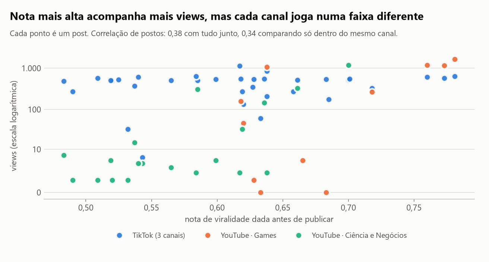
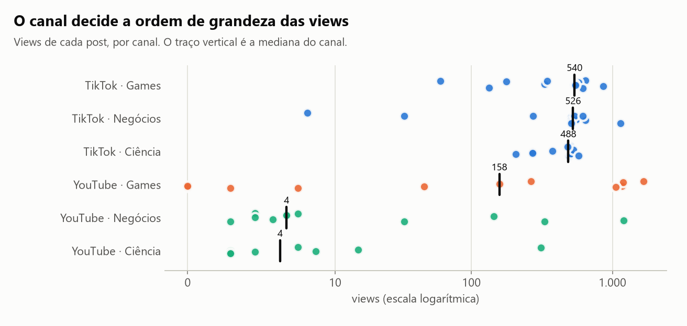
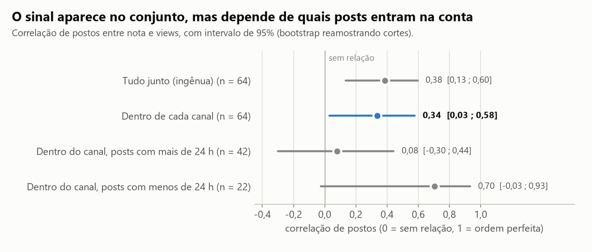
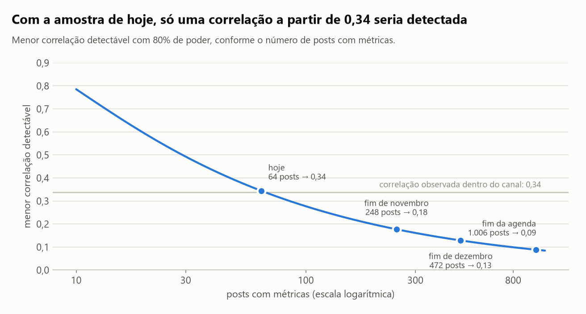

# A nota de viralidade prevê as views?

Numa operação real de cortes de vídeo para Shorts e TikTok, cada corte recebe, antes de ser publicado, uma nota
de viralidade entre 0 e 1 (um juiz de IA com oito critérios, combinado com métricas do vídeo de origem). A nota
decide o que é publicado primeiro. Este projeto confere se ela acerta.

A resposta muda três vezes conforme a comparação fica mais justa: **0,38 → 0,34 → 0,08**. Com a amostra de hoje,
a conclusão honesta é "ainda não dá para saber", e o projeto diz exatamente quanto dado falta.

> **English summary.** Validating a pre-publication "virality score" against real views in a short-video clipping
> operation (680 scored clips, 64 published posts with metrics so far). The naive Spearman correlation is 0.38
> (p = 0.002). Comparing only within the same channel it is 0.34 (95% CI 0.03 to 0.58). Restricting to posts whose
> views have stabilized (24 h or more) it drops to 0.08 (95% CI −0.30 to 0.44). The estimate is unstable, the
> sample only detects correlations of 0.34 or more, and no component of the score survives a false-discovery
> correction. Includes a cluster bootstrap, stratified permutation tests, a power plan tied to the publishing
> schedule, and two design findings (range restriction; an approval threshold that no clip reaches). A living
> analysis: it re-runs on each daily metrics snapshot. Data is anonymized; code and notebook are in Portuguese.

Coleta usada nestes números: **10/11/2026**, 64 posts de 35 cortes, mediana de 39 horas no ar.

## Resultados

| Pergunta | Resposta |
|---|---|
| A nota acompanha as views, juntando tudo? | Sim: correlação **0,38** (p = 0,002) |
| E comparando só dentro do mesmo canal? | **0,34**, com intervalo de 95% de 0,03 a 0,58 |
| E só entre posts com views já estabilizadas (24 h ou mais)? | **0,08**, com intervalo de −0,30 a 0,44 |
| Em views, quanto rende a nota alta? | 1,06 vez as views da nota baixa, com intervalo de 0,98 a 2,78 |
| Alguma parte da nota funciona melhor? | Nenhuma resiste à correção para múltiplos testes (menor p ajustado: 0,29) |
| O que mais explica as views? | O canal: mediana de **4 a 540 views** conforme a plataforma e o nicho |
| Quanto dado falta? | 194 posts para detectar correlação de 0,2; a agenda chega lá no fim de novembro |

### 1. A resposta ingênua esconde o canal



Juntando todos os posts, nota e views têm correlação de 0,38. Só que cada canal (plataforma e nicho) joga numa
faixa própria, e o nicho de games recebe as notas mais altas e é também o único com audiência no YouTube.



| Canal | Posts | Mediana de views | Mediana da nota |
|---|---|---|---|
| TikTok · Games | 12 | 540 | 0,66 |
| TikTok · Negócios | 12 | 527 | 0,61 |
| TikTok · Ciência | 10 | 488 | 0,52 |
| YouTube · Games | 11 | 158 | 0,67 |
| YouTube · Negócios | 11 | 4 | 0,60 |
| YouTube · Ciência | 8 | 4 | 0,52 |

### 2. Dentro do canal o sinal continua, mas não se sustenta



| Comparação | Posts | Correlação | IC 95% | p |
|---|---|---|---|---|
| Tudo junto (ingênua) | 64 | 0,38 | 0,13 a 0,60 | 0,002 |
| Dentro de cada canal | 64 | 0,34 | 0,03 a 0,58 | 0,008 |
| Dentro do canal, posts com mais de 24 h | 42 | 0,08 | −0,30 a 0,44 | 0,64 |
| Dentro do canal, posts com menos de 24 h | 22 | 0,70 | −0,03 a 0,93 | 0,004 |

Comparando cada corte só com os do mesmo canal, a correlação cai pouco. Mas as views chegam no primeiro dia (um
post do TikTok com mais de 24 horas ganhou, em mediana, 1 view entre duas coletas), e o lote mais recente do
YouTube teve mediana de 76 views contra 4 dos anteriores. Entre os posts com views estabilizadas, a correlação é
0,08. O sinal vinha dos 22 posts mais novos.

Com 64 posts publicados em quatro dias, não dá para separar o efeito da nota do efeito do lote do dia. Uma
estimativa que vai de 0,08 a 0,70 conforme o recorte é instabilidade, não descoberta. Duas checagens apontam na
mesma direção: sem o post de mais views de cada canal, o intervalo inclui o zero (0,31; −0,07 a 0,58); comparando
só posts do mesmo canal e do mesmo dia, a correlação é 0,19 (−0,21 a 0,51).

### 3. Quanto dado falta



| Correlação a detectar | Posts necessários | Quando a agenda chega lá |
|---|---|---|
| 0,5 | 30 | já atingido |
| 0,4 | 47 | já atingido |
| 0,3 | 85 | semana de 9/11 |
| 0,2 | 194 | semana de 23/11 |

Hoje a amostra só detecta, com 80% de poder, correlações de 0,34 ou mais. A agenda já programada soma 248 posts no
fim de novembro e 472 no fim de dezembro, e as métricas são coletadas todo dia. A partir do fim de novembro a
análise tem amostra para responder, e mais dias de publicação para separar o efeito do lote.

### 4. Dois achados de desenho

- **O limiar de aprovação não aprova nada.** O pipeline aprova cortes com nota a partir de 0,80. A maior nota entre
  os 680 cortes é 0,799. O que se publica são os melhores disponíveis; o limiar precisa ser recalibrado.
- **Só a nota alta vai ao ar.** Os cortes pontuados têm nota entre 0,34 e 0,67 (10º ao 90º percentil); os
  publicados, entre 0,52 e 0,71. Medir numa faixa estreita encolhe a correlação, e não há como saber quantas views
  teria um corte de nota baixa. O único jeito de saber o que a nota descarta é publicar, de propósito, uma amostra
  sorteada de cortes de nota baixa.

## Decisões de método

- **Correlação dentro do canal.** O posto de cada corte é calculado só entre os posts do mesmo canal; a correlação
  usa esses postos. Tira o efeito da audiência do canal sem supor forma para a relação.
- **Bootstrap por corte.** O mesmo corte aparece nas duas plataformas, então as linhas não são independentes. O
  bootstrap sorteia cortes inteiros, com todos os seus posts.
- **Teste de permutação estratificado.** O p-valor vem de embaralhar as views dentro de cada canal.
- **Views com 24 horas ou mais.** Duas coletas mostram que as views chegam no primeiro dia; antes disso o número
  ainda sobe.
- **Múltiplos testes.** Os dez componentes da nota são avaliados com ajuste de Benjamini-Hochberg.
- **Poder ligado à agenda.** O tamanho de amostra necessário é cruzado com os posts já programados, para dizer em
  que semana a pergunta passa a ter resposta.

## Limitações

- 64 posts de 35 cortes, publicados em quatro dias: a amostra é pequena e concentrada.
- Não é experimento. A ordem de publicação não foi sorteada, e a nota pode estar ligada ao dia e ao horário.
- Só há resultado para os cortes que a própria nota escolheu publicar.
- Uma métrica só (views). Retenção e tempo assistido existem para o TikTok e ficam para a próxima leitura.
- Os pesos da nota são recalibrados ao longo do tempo; aqui todas as versões estão juntas.

## Como rodar

Pré-requisito: [`uv`](https://docs.astral.sh/uv/getting-started/installation/).

```bash
uv sync
uv run python scripts/rodar_analise.py   # regera reports/resultados.json e as figuras
uv run pytest                            # 14 testes
```

Os extratos anonimizados estão em `data/`. O script `scripts/extrair_dados.py` os regenera a partir da pasta
privada da operação; sem acesso a ela, use os extratos versionados.

O notebook [`analise.ipynb`](analise.ipynb) conta a história completa.

## Dados e privacidade

Os extratos não trazem títulos, canais de origem, links, legendas nem identificadores de conta. Cada corte é um
hash curto, sem volta para o vídeo original. Os vídeos de origem são de terceiros, usados pela operação em
campanhas de cortes autorizadas; aqui só entram notas e métricas.

---

Hélcio Venâncio · [github.com/ghitflux](https://github.com/ghitflux) · Licença MIT

Outros projetos: [`dedico-trafego-decisao`](https://github.com/ghitflux/dedico-trafego-decisao) ·
[`lead-scoring-conversao`](https://github.com/ghitflux/lead-scoring-conversao) ·
[`ab-test-simulado`](https://github.com/ghitflux/ab-test-simulado) ·
[`stats-foundations`](https://github.com/ghitflux/stats-foundations)

## Como este estudo foi feito

Este estudo foi construído com assistência de IA (Claude Code, da Anthropic), usada como par de programação.
Declaro a divisão do trabalho porque ela importa para quem avalia:

- **Meu:** a operação e os dados (a rede de cortes, a nota de viralidade que ela usa e a coleta diária de métricas são minhas) e a pergunta: a nota em que a operação confia prevê alguma coisa?, a leitura crítica dos resultados e a decisão do que publicar e do que declarar como limitação.
- **Com o assistente:** a escolha do método, a implementação do código, dos testes e dos gráficos, e a redação,
  que revisei.
- **Como conferir:** todo número deste README sai de `reports/resultados.json`, gerado por `scripts/rodar_analise.py`; os testes em `tests/` conferem as funções estatísticas contra casos de resposta conhecida.

É o mesmo jeito que trabalho nos sistemas que entrego: a IA acelera a implementação, e a responsabilidade pelo que
está escrito aqui é minha.

*In English: built with AI assistance (Claude Code) as a pair programmer. Direction, business context, critical
review of the results and the decision of what to publish are mine; method choice, implementation and writing were
done with the assistant and reviewed by me.*
